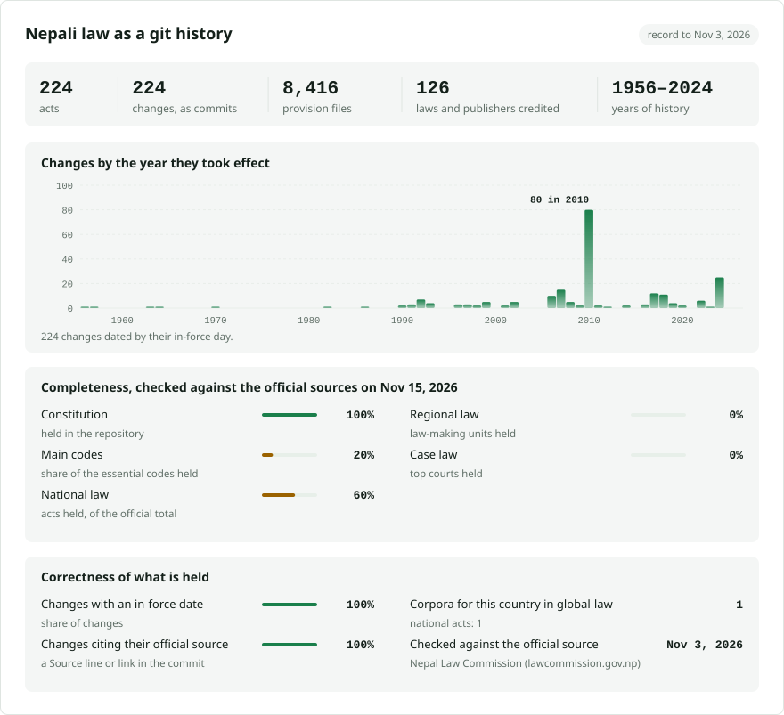

# Nepal: law history in git

<picture>
<source media="(prefers-color-scheme: dark)" srcset="data/effort-dark.svg">

</picture>

The law of Nepal as a git history: one file per article or section, one commit per version on the day it took effect, and the act that made each change as the commit's author. `git blame` names the act behind every section; `git log` lists every change to a section; picking a date gives the text in force that day.

Part of [lexifina/global-law](https://github.com/lexifina/global-law), one git history for every country's law: this is Nepal's national law, which global-law reads at `nepal/national/acts/`.

**What is in it now:** the Constitution and 223 Acts from the Law Commission's index of Acts in force, each in one version, its current text (224 versions). It is not yet a full history: the amendments behind each text are named in its commit, but earlier wordings are not rebuilt. [`REPRODUCE.md`](REPRODUCE.md) lists every act with its version; `data/versions.json` gives each one's source.

Each Act is in a folder named after it and its years in the Gregorian and Bikram Sambat calendars (`civil-service-act/1993/2049/` is the Civil Service Act, 2049 (1993)); the Constitution is in [`constitution/constitution/`](constitution/constitution/) and the Labour Act, 2017 (2074) in [`labour-act/`](labour-act/). Schedules are kept together in one file per Act. `data/paths.json` maps each act id to its folder.

The text is in English, the Nepal Law Commission's official English text. The Nepali text is not part of this record: the Commission's Nepali PDFs use legacy fonts whose text does not extract correctly.

## Questions as git commands

| Question | Command |
| --- | --- |
| Every change to Section 43 (home leave) of the Labour Act | `git log -p --word-diff -- labour-act/sec-043.md` |
| Which act wrote each line of Section 43? | `git blame labour-act/sec-043.md` |
| Every version of the Labour Act, with the day each took effect | `git log --format="%h %(trailers:key=In-force,valueonly,separator=) %an" -- labour-act` |
| Section 43 as in force on 1 January 2020 | `python tools/on.py 2020-01-01 labour-act sec-043` |

**Outside git**, we also host this record publicly, for free:

- **[Ask Claude about the law of Nepal](https://global-law.lexifina.com/v1/try_claude?country=nepal)**: opens Claude with a first question ready.
- **[Ask ChatGPT](https://global-law.lexifina.com/v1/try_chatgpt?country=nepal)**: the same question in ChatGPT.
- **[Search the law of Nepal on our site](https://lexifina.com/law?country=nepal&q=home+leave)**: a search for "home leave", with each provision's text and its versions, no account needed.
- **[Developer REST API](https://global-law.lexifina.com/v1/search_law?query=home+leave&jurisdiction=nepal)**: the same search as JSON, with no key. See the [documentation here](https://lexifina.com/api/global-law).

Both assistants read the record through the free Global law connector (MCP, `https://global-law.lexifina.com/mcp`); the first time, the chat gives you the link that adds it. Ask in English or in Nepali.

**Host it yourself easily.** All it takes is git and Python, and the tools run on your machine:

```sh
git clone --depth 1 https://github.com/lexifina/global-law && cd global-law
python3 tools/countries.py add nepal/national/acts
python3 tools/law.py show 2026-01-01 nepal/national/acts/labour-act/sec-043.md
```

Opened in Claude Code, Cursor, VS Code or Codex, the clone also starts a local MCP server with the same tools ([MCP.md](https://github.com/lexifina/global-law/blob/main/MCP.md)).

## Dates

Each commit is dated at noon, Asia/Kathmandu, on the day the version took effect, and carries it in its `In-force:` trailer:

- for an Act whose cover lists no amendments, its date of authentication (Nepali Acts commence on authentication unless they say otherwise), as the Gregorian date the Law Commission prints beside the Bikram Sambat one;
- for an amended Act, the authentication date of the latest amendment its cover lists; the Constitution is dated by its Second Amendment, 18 June 2020;
- where the cover's amendment dates could not be read safely (33 Acts), the day the Internet Archive captured the text from the Commission;
- git cannot store dates before 1970, so the 4 earlier versions are dated 1 January 1970 with the real day in `In-force:`. Ask for a date with `tools/on.py`, not `git log --before`.

An unamended Act is credited to itself, an amended one to the latest amendment its cover lists, with the Act and its earlier amendments named in the commit (190 versions). The Constitution and the 33 Acts dated by the archive are credited to the publisher, the Nepal Law Commission.

## How it is checked

- `tools/check_repo.py` reads every version back from git on the day it took effect and on the day before, and compares it with the corpus: 224 versions of 224 acts, 0 mismatches.
- No merge commits on `main`, no commit dates that go backwards, nothing dated after the build, and every commit's trailers parse.
- `tools/build.py` writes the history from one corpus file, and the same corpus gives the same commit hashes. The results are in [`REPRODUCE.md`](REPRODUCE.md); no second build has been compared yet.
- [vulnerabilities/](vulnerabilities/README.md): possible drafting mistakes in Nepali law, found by global-law's detectors and checked by hand.

## What it does not show

- **Earlier wordings.** Each act is one version, its latest English text; earlier texts (for the Constitution, its 2015 and 2016 wordings) are not rebuilt.
- **The latest amendments, for some Acts.** Some English texts are older than the latest Nepali text; each commit says which amendment its wording reflects.
- **Acts with no official English text**, the 2017 Civil and Criminal Codes and their procedure codes among them: 124 of the 372 Acts in the Commission's index of Acts in force. Another 24 English texts could not be split into sections reliably.
- **Headings and notes.** Part and chapter headings, footnotes, page headers and amendment marks are left out; each section keeps its number and heading.
- **Rules and regulations, provincial and local law, and case law.**

## Sources

| Source | Kind | Past versions | Notes |
| --- | --- | --- | --- |
| [Nepal Law Commission](https://lawcommission.gov.np/) | Official English texts of the Constitution and the Acts | no, the current consolidated text only | Acts chosen from the Commission's index of Acts in force (in Nepali); most texts from its former English site, as captured by the Internet Archive |

## Licence

See [`LICENSE`](LICENSE). The text is the Law Commission's official publication, which states no terms of use; Nepal's Copyright Act 2059 (2002) does not name legislation among the matters it excludes, so this repository relies on the text being an official publication offered openly for public reading. The arrangement, tables, commit messages and tools are CC BY 4.0.

No AI model wrote, translated or corrected legal text; the scripts were written by an AI model (see [`REPRODUCE.md`](REPRODUCE.md)).

## More

From [lexifina/global-law](https://github.com/lexifina/global-law):

- [FEATURES.md](https://github.com/lexifina/global-law/blob/main/FEATURES.md): every feature, and what every corpus must support (`git blame`, `law.py`, the MCP tools)
- [FAQ.md](https://github.com/lexifina/global-law/blob/main/FAQ.md): questions and answers · [CONTRIBUTING.md](https://github.com/lexifina/global-law/blob/main/CONTRIBUTING.md): proposing changes · [MCP.md](https://github.com/lexifina/global-law/blob/main/MCP.md): the MCP server · [REPRODUCE.md](https://github.com/lexifina/global-law/blob/main/REPRODUCE.md): how it was built · [CHANGELOG.md](https://github.com/lexifina/global-law/blob/main/CHANGELOG.md)
- [FRESHNESS.md](https://github.com/lexifina/global-law/blob/main/FRESHNESS.md): how current each corpus is · [Monitoring](https://github.com/lexifina/global-law/tree/main/monitoring): whether updates are running · [WATCHING.md](https://github.com/lexifina/global-law/blob/main/WATCHING.md): how each official source is watched for changes
- [performance/](https://github.com/lexifina/global-law/tree/main/performance): how fast the tools are, measured
- [visualisations/](https://github.com/lexifina/global-law/tree/main/visualisations): charts and bridges across the world's law
- [Vulnerabilities](https://github.com/lexifina/global-law/tree/main/vulnerabilities): mistakes in legislation as published
